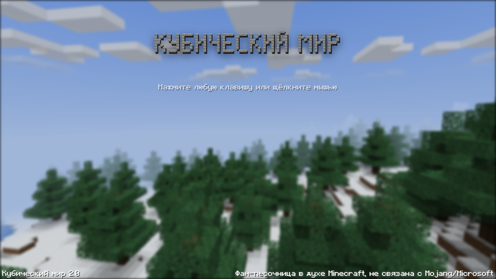
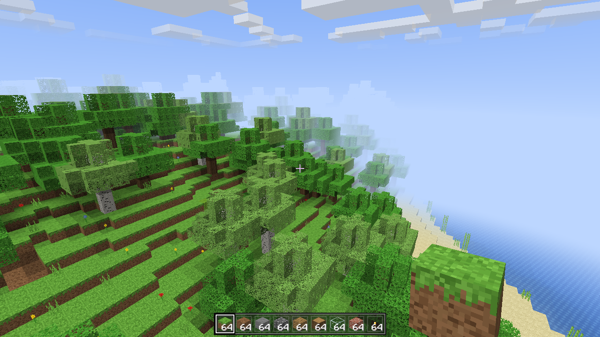
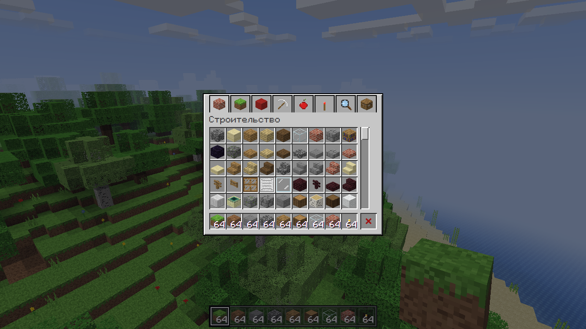

<div align="center">

# AlexMine - Кубический мир

**Кубический мир - воксельная песочница на одной HTML-странице. Работает в браузере без сервера и без интернета: откройте `index.html` или играйте онлайн.**

[**▶ Играть онлайн →**](https://alexalesha.github.io/AlexMine/) &nbsp;·&nbsp; [English version of this file](README.md)

[](#) [](https://github.com/ALEXalesha/AlexMine/actions/workflows/ci.yml) [](LICENSE) [](https://developer.mozilla.org/docs/Web/HTML) [](https://alexalesha.github.io/AlexMine/) [](https://claude.com/claude-code)

Код, тесты и документация этого проекта написаны Claude (Anthropic) в Claude Code. Идеи, проверка и решения - Алексей.

</div>

> Фанатская песочница в духе Minecraft. Не связана с Mojang и Microsoft и не одобрена ими.
> Minecraft - товарный знак Mojang Synergies AB. Все текстуры, звуки и шрифт сделаны кодом этого
> репозитория, из оригинальной игры не взято ничего.







## Что есть в игре

- **Бесконечный мир по зерну:** куски 16×16×128 блоков строятся вокруг героя в фоновых потоках;
  равнины, леса, пустыни, снежные биомы, горы, океаны, пещеры и руды.
- **Творческий режим и выживание.** Здоровье, голод, еда, урон от падения, смерть и возрождение,
  кровать.
- **День и ночь** (сутки 20 минут), солнце, луна, звёзды, облака; **погода**: дождь, гроза с
  молниями, снег в холодных биомах и высоко в горах.
- **Блоки и предметы:** строительные блоки, текущие вода и лава, огонь, верстак, печь, сундук,
  инструменты и броня, щит.
- **Мобы:** коровы, курицы, зомби, скелеты (стреляют и горят на солнце), пауки, криперы,
  эндермены; деревни с жителями и торговлей.
- **Нижний мир и Край** с эндер-драконом - главным финалом игры.
- **Красный камень** (пыль, факелы, рычаги, кнопки, двери, поршни и другое), **чары** и
  наковальня, **зелья**, **рыбалка**, лодка, вагонетки и рельсы, опыт, 24 достижения.
- Вид от первого и третьего лица (F5), синтезированные звуки, свой пиксельный шрифт.
- Миры и настройки сохраняются в браузере (IndexedDB).

## Управление

| Клавиша | Действие |
|---|---|
| W A S D | ходьба (клавиши меняются в «Настройки → Управление») |
| Пробел | прыжок; двойное нажатие в творческом режиме - полёт |
| Левый Shift | красться |
| Левый Ctrl или двойное W | бег |
| Левая кнопка мыши | ломать блок, бить |
| Правая кнопка мыши | поставить блок, использовать, есть (удерживать) |
| Средняя кнопка мыши | взять блок, на который смотришь |
| Колесо, 1-9 | выбор ячейки панели |
| E | инвентарь |
| Q | выбросить предмет |
| F1 / F2 / F3 / F5 | спрятать интерфейс / снимок / отладка / вид камеры |
| F | полный экран игры |
| Esc | пауза и свободный курсор; второй Esc - продолжить |

В собственном полном экране игры (клавиша F или кнопка в меню паузы) Chrome и Edge оставляют Esc
игре (`navigator.keyboard.lock`): чтобы выйти из полного экрана, **удерживайте Esc** или нажмите F.

## Запуск у себя

Откройте `index.html` в Chrome, Edge или Firefox. three.js r149 лежит в `vendor/` (MIT, см.
`vendor/three.LICENSE.txt`), ничего не скачивается.

## Проверки

Законы игры - проверки Playwright в `tests/`. Они открывают страницу по файловому адресу в
безголовом Chromium, по одной за раз:

```
npm install
npx playwright install chromium
npm test
```

Захват мыши в проверках всегда поддельный: настоящий `requestPointerLock` в безголовом Chromium
на Windows может зажать курсор пользователя. `npm run screenshots` делает кадры выше.

## История

Игра сделана в сборнике MixOfProject (папка
`web/minecraft_clone_3d_1`), там она же работает в настольном приложении «Хаб». Здесь игра
лежит вместе со всей историей коммитов.

## Лицензия

MIT, см. [LICENSE](LICENSE). three.js - MIT.
